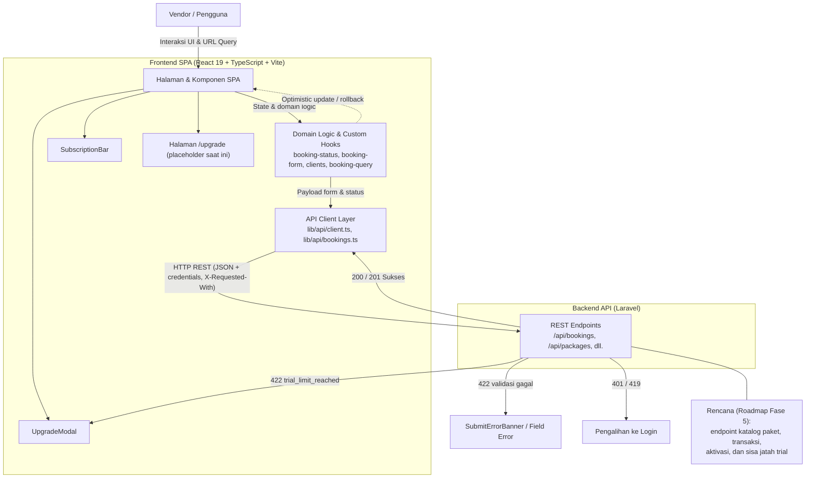
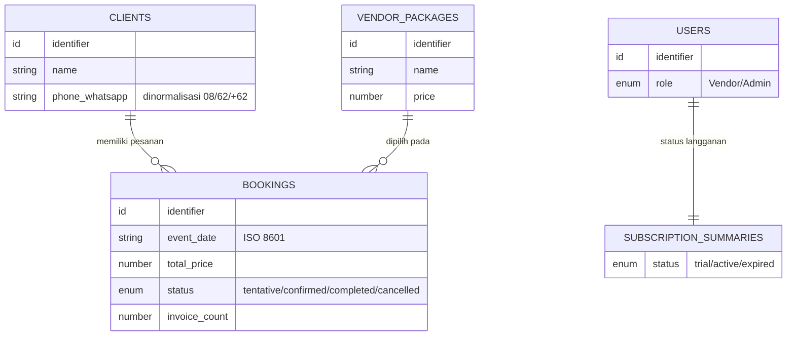

# PRD — Project Requirements Document

## 1. Overview

**Booking Vendor** adalah aplikasi operasional internal berbasis web untuk vendor pernikahan (*wedding vendor*). Aplikasi ini bukan marketplace publik: klien tidak perlu membuat akun, dan seluruh pencatatan dilakukan sendiri oleh vendor.

Masalah yang diselesaikan:

- Vendor sering mencatat jadwal acara secara manual sehingga rawan **jadwal ganda** (*double booking*) pada tanggal yang sama.
- Data kontak klien (nama, nomor WhatsApp) tersebar dan formatnya tidak seragam, sehingga sulit mencari riwayat pesanan klien lama.
- Pembaruan status acara (`tentative` → `confirmed` → `completed` / `cancelled`) membutuhkan respons cepat tanpa menunggu server.
- Penggunaan aplikasi perlu dibatasi saat masa uji coba dan ditingkatkan melalui langganan berbayar.

Tujuan utama:

1. Menyediakan satu tempat untuk mencatat, mencari, memfilter, dan memperbarui pesanan beserta statusnya.
2. Mencegah bentrok tanggal acara melalui penanda tanggal terpakai (*taken dates*) pada form.
3. Menormalkan dan mencari data klien berdasarkan nama atau nomor WhatsApp.
4. Menegakkan kuota masa uji coba dan menyediakan jalur langganan (katalog paket, pembayaran manual, status, dan perpanjangan).

---

## 2. Requirements

**Persyaratan fungsional (kondisi saat ini — sudah berjalan):**

- Vendor dapat melihat daftar pesanan dan memfilternya berdasarkan bulan acara, status, dan kata kunci pencarian; filter tersinkronisasi dengan URL.
- Vendor dapat membuat dan mengedit pesanan; form memuat daftar tanggal terpakai sebagai peringatan bentrok.
- Vendor dapat mencari klien lama lewat nama atau nomor WhatsApp dengan normalisasi format `08`, `62`, `+62`.
- Status pesanan hanya boleh bergerak melalui transisi yang sah dan diperbarui secara optimistik dengan *rollback* bila gagal.
- Halaman detail pesanan menampilkan informasi kontrak, pintasan WhatsApp, status invoice, dan riwayat.
- Kegagalan kuota uji coba (`422 trial_limit_reached`) harus memunculkan `UpgradeModal` tanpa menghapus isian form.
- Error validasi server dipetakan ke field input yang sesuai; error jaringan menyediakan aksi coba lagi; sesi berakhir (401/419) mengalihkan ke login.

**Persyaratan fungsional (roadmap — belum dibangun):**

- Tersedianya katalog paket langganan yang nyata pada halaman `/upgrade` dengan harga, masa aktif, batas booking, dan batas invoice.
- Alur pembayaran manual: ringkasan pesanan, pembuatan transaksi, instruksi transfer, status menunggu konfirmasi, dan pembuatan ulang transaksi.
- Penegakan kuota trial maksimal 2 booking dan 2 invoice dengan sisa jatah, peringatan mendekati batas, dan penolakan saat submit.
- `SubscriptionBar` menampilkan status langganan, tanggal berakhir, sisa hari, dan masa tenggang.
- Halaman `/upgrade` memuat riwayat pembayaran dan alur perpanjangan paket.
- Backend Laravel menyediakan tabel paket/langganan/pembayaran serta endpoint katalog, transaksi, aktivasi, dan perhitungan sisa jatah trial.

**Persyaratan non-fungsional:**

- Antarmuka responsif: tabel pada desktop, kartu pada layar kecil.
- Komunikasi API berupa REST JSON dengan pengiriman kredensial sesi.
- Validasi dijalankan di klien lebih dulu (fokus ke input bermasalah pertama) dan ditegakkan ulang di server.
- Perubahan status bersifat optimistik dan aman dari kegagalan (rollback + notifikasi).
- Form tidak boleh kehilangan data pengguna saat terjadi kegagalan kuota.

---

## 3. Core Features

### 3.1 Kemampuan yang Sudah Berjalan (kondisi saat ini)

- **Manajemen Siklus Hidup Booking** — Status pesanan `tentative`, `confirmed`, `completed`, `cancelled` dikelola melalui `StatusControls` dan `booking-status.ts`, dengan validasi transisi yang sah.
- **Pembaruan Status Optimistik** — `useBookingStatusChange` menerapkan perubahan langsung di UI dan mengembalikannya (*rollback*) bila API gagal, disertai notifikasi.
- **Pencegahan Double Booking** — Form memuat daftar `takenDates` dan `BookingFormSidebar` menampilkan penanda tanggal yang sudah terisi.
- **Pencarian & Lookup Klien** — `ClientLookup` mencari berdasarkan nama atau nomor WhatsApp (normalisasi `08`, `62`, `+62`), menampilkan riwayat pesanan, dan mengisi form otomatis.
- **Filter & Sinkronisasi URL** — `BookingFiltersBar` menyaring berdasarkan bulan (`YYYY-MM`), status, dan kata kunci dengan *debounce* 300ms, tersinkronisasi dua arah ke query URL.
- **Form Interaktif dengan Ringkasan Live** — `BookingFormSidebar` menampilkan ringkasan data, pemilih paket cepat, dan validasi klien sebelum request dikirim.
- **Pengeditan dengan Diff Perubahan** — `BookingEditPage` menghitung `changedFieldLabels` dan menonaktifkan simpan bila tidak ada perubahan.
- **Halaman Detail Pesanan** — Informasi kontrak, pintasan WhatsApp (`wa.me`), status invoice, dan riwayat.
- **Trial Guard & Penanganan Error** — Error `trial_limit_reached` (422) membuka `UpgradeModal` tanpa mereset form; validasi server dipetakan ke field lokal via `mapServerErrors`; `SubmitErrorBanner` menampilkan maksimal 4 error dengan label bahasa Indonesia.
- **Rute Terproteksi** — `DashboardLayout` melindungi rute dashboard dan menyediakan konteks pengguna (Vendor/Admin).

### 3.2 Rencana Pengembangan (Roadmap — belum dibangun)

**Fase 1 — Katalog Paket** *(high)*
Membangun halaman `/upgrade` yang nyata untuk menggantikan placeholder.
- *Daftar Paket* — Tiga pilihan paket (Bulanan, 3 Bulan, Tahunan) beserta harga dan lama masa aktif dalam satu tampilan.
- *Rincian Manfaat* — Penjelasan manfaat tiap paket, termasuk batas booking dan batas invoice.
- *Perbandingan Paket* — Penyandingan paket berdampingan agar mudah memilih.
- *Paket Rekomendasi* — Penanda paket paling hemat atau paling populer.

**Fase 2 — Mulai Pembayaran** *(high)*
Alur memilih paket lalu membuat transaksi dan memperoleh instruksi transfer manual.
- *Ringkasan Pesanan* — Paket terpilih, harga, dan total sebelum transaksi dibuat.
- *Instruksi Transfer* — Tujuan transfer dan nominal yang harus dibayar setelah transaksi tercatat.
- *Menunggu Konfirmasi* — Transaksi yang sudah dibuat dan sedang menunggu konfirmasi admin.
- *Ulangi Transaksi* — Pembuatan transaksi baru bila transaksi sebelumnya batal atau kedaluwarsa.

**Fase 2 — Kuota Trial** *(high)*
Menegakkan batas masa uji coba maksimal 2 booking dan 2 invoice; percobaan ketiga tetap boleh mengisi form tetapi ditolak saat submit dengan `trial_limit_reached` memakai `UpgradeModal` yang sudah ada.
- *Sisa Jatah Trial* — Menampilkan berapa booking dan invoice lagi yang bisa dibuat.
- *Peringatan Mendekati Batas* — Pemberitahuan saat jatah tinggal satu.
- *Penolakan Saat Submit* — Menahan pengiriman form ketika kuota habis dan menampilkan pesan `trial_limit_reached`.
- *Form Tetap Utuh* — Membuka `UpgradeModal` tanpa menghapus isian form, memanfaatkan pola penanganan error `trial_limit_reached` yang sudah ada.

**Fase 3 — Status Langganan** *(medium)*
Memperluas `SubscriptionBar` yang sudah ada.
- *Label Status* — Status langganan saat ini dengan penanda warna yang mudah dibaca.
- *Tanggal Berakhir* — Kapan masa aktif berakhir beserta hitungan hari tersisa.
- *Masa Tenggang* — Tanda dan waktu tambahan singkat ketika langganan baru saja kedaluwarsa.

**Fase 4 — Riwayat & Perpanjangan** *(medium)*
Memperluas halaman `/upgrade`.
- *Riwayat Pembayaran* — Daftar transaksi sebelumnya beserta paket, nominal, tanggal, dan statusnya.
- *Perpanjang Langganan* — Memperpanjang paket yang sama tanpa mengisi ulang data.
- *Aktivasi Setelah Konfirmasi* — Langganan aktif setelah pembayaran dikonfirmasi admin, dengan masa aktif diperpanjang dari tanggal berakhir sebelumnya.

**Fase 5 — Layanan Langganan** *(high)*
Melengkapi backend Laravel di luar repo frontend: tabel plans/subscriptions/payments serta endpoint katalog, transaksi, aktivasi, dan perhitungan sisa jatah trial.
- *Katalog Paket Server* — Menyimpan daftar paket dan harga; harga 3 bulan dan tahunan sebagai konfigurasi agar mudah diubah.
- *Pembuatan Transaksi* — Mencatat transaksi pembayaran manual dan mengaitkannya ke vendor serta paket.
- *Aktivasi & Perpanjangan* — Menghitung tanggal berakhir baru saat pembayaran dikonfirmasi atau langganan diperpanjang.
- *Sisa Jatah Trial* — Menghitung pemakaian booking dan invoice dari data nyata agar jatah trial tidak direset saat vendor naik ke paket berbayar.

---

## 4. User Flow

### 4.1 Alur yang Sudah Berjalan

1. Vendor membuka `/bookings`; daftar pesanan tampil dengan filter bulan, status, dan pencarian yang tersimpan di URL.
2. Vendor menekan buat pesanan baru → `/bookings/new`.
3. Vendor mencari klien lewat `ClientLookup`; bila klien lama dipilih, data form terisi otomatis. Jika baru, vendor mengisi data klien secara manual.
4. Vendor memilih tanggal acara dan paket; sidebar menampilkan ringkasan serta peringatan bila tanggal sudah terpakai.
5. Vendor mengirim form → `POST /bookings`.
   - Sukses → notifikasi dan pengalihan.
   - Validasi gagal (422) → error muncul pada field terkait.
   - `trial_limit_reached` (422) → `UpgradeModal` terbuka, isian form tetap utuh.
6. Vendor membuka `/bookings/:id` untuk melihat detail dan mengubah status melalui `StatusMenu`/`StatusStepper` secara optimistik; bila gagal, status dikembalikan dan toast kesalahan tampil.
7. Vendor membuka `/bookings/:id/edit` untuk mengubah data; tombol simpan aktif hanya bila ada perubahan.

### 4.2 Alur Roadmap (sesuai urutan fase)

1. **Fase 1** — Vendor membuka `/upgrade`, melihat tiga paket berdampingan lengkap dengan harga, masa aktif, batas booking/invoice, dan penanda paket rekomendasi.
2. **Fase 2 (pembayaran)** — Vendor memilih paket → melihat ringkasan pesanan (paket, harga, total) → membuat transaksi → menerima instruksi transfer → status transaksi menjadi "menunggu konfirmasi admin". Bila transaksi batal/kedaluwarsa, vendor membuat transaksi baru.
3. **Fase 2 (kuota trial)** — Selama masa uji coba, vendor melihat sisa jatah booking dan invoice. Saat jatah tinggal satu, muncul peringatan. Pada percobaan melebihi batas, form tetap bisa diisi tetapi ditolak saat submit dengan `trial_limit_reached` dan `UpgradeModal` terbuka tanpa menghapus isian.
4. **Fase 3** — Vendor memantau `SubscriptionBar` untuk melihat label status (trial/active/expired), tanggal berakhir, sisa hari, dan masa tenggang.
5. **Fase 4** — Vendor membuka `/upgrade` untuk melihat riwayat pembayaran, memperpanjang paket yang sama, dan melihat langganan aktif setelah admin mengonfirmasi pembayaran.
6. **Fase 5** — Di sisi server, backend menyimpan katalog paket dan harga, mencatat transaksi terkait vendor dan paket, menghitung tanggal berakhir baru pada aktivasi/perpanjangan, serta menghitung sisa jatah trial dari data nyata.

---

## 5. Architecture

Susunan nyata saat ini memisahkan Frontend SPA (React 19 + Vite) dengan Backend API (Laravel) melalui lapisan API Client tipis. Frontend menangani validasi lokal, pencocokan `takenDates`, dan transisi status optimistik; backend menegakkan aturan bisnis dan kuota, lalu merespons dengan JSON atau kode status HTTP yang memicu reaksi UI.

Catatan: kotak *Planned* menandai bagian yang belum ada di codebase dan baru diusulkan pada roadmap; sisanya menggambarkan kondisi terkini.

---

## 6. Database Schema

Dokumentasi codebase tidak menyebutkan mesin database maupun nama tabel secara eksplisit; entitas berikut diturunkan dari model domain yang disebut (`Booking`, `Client`, `VendorPackage`, `CurrentUser`, `SubscriptionSummary`) dan endpoint yang ada (`/api/bookings`, `/api/packages`). Kolom hanya dicantumkan bila benar-benar dirujuk oleh dokumentasi.

**Entitas yang ada saat ini:**

**bookings** — pesanan/acara.
- `id` — identifier pesanan.
- `client` — data klien tersarang (relasi ke `clients`).
- `event_date` — tanggal acara, disimpan sebagai string ISO.
- `total_price` — nilai kontrak pesanan (number).
- `status` — enum: `tentative` | `confirmed` | `completed` | `cancelled`.
- `invoice_count` — jumlah invoice pada pesanan (number).

**clients** — data klien.
- `id` — identifier klien.
- `name` — nama klien.
- `phone` / nomor WhatsApp — disimpan ternormalisasi (`08`, `62`, `+62`) dan dipakai untuk lookup riwayat pesanan.

**vendor_packages** — paket yang dipilih pada pesanan (dipakai pemilih paket cepat dan endpoint `/api/packages`).
- `id` — identifier paket.
- `name` — nama paket.
- `price` — harga paket. *(Rincian kolom lain tidak disebutkan di dokumentasi.)*

**users (CurrentUser)** — pengguna aplikasi dengan peran `Vendor` atau `Admin`.
- `id` — identifier pengguna.
- `role` — enum: `Vendor` | `Admin`.

**subscription_summaries** — ringkasan langganan yang ditampilkan `SubscriptionBar`.
- `status` — enum: `trial` | `active` | `expired`.

**Entitas yang direncanakan (Roadmap Fase 5, belum ada):** `plans`, `subscriptions`, `payments` — belum ada di codebase sehingga kolomnya belum dapat dirinci.

---

## 7. Tech Stack

Teknologi diambil dari codebase yang sudah ada (bukan default):

**Frontend (SPA)**
- React 19 + TypeScript
- Vite 8 sebagai build tool
- React Router DOM v7 — routing dashboard terproteksi (`DashboardLayout`)
- Tailwind CSS v4 via `@tailwindcss/vite` — styling
- Lucide React — ikon
- Recharts — visualisasi data
- Clsx — penggabungan class
- Oxlint — linting
- TSX — eksekusi skrip pengujian logika (`scripts/test-booking-form.ts`, `scripts/test-api-contract.ts`)
- Playwright — pengujian end-to-end

**Backend (API)**
- Laravel (PHP) + Composer, dijalankan via `php artisan serve`
- REST JSON endpoint: `/api/bookings`, `/api/packages`, dll.
- Validasi dan aturan bisnis di sisi server, termasuk verifikasi kuota langganan dan respons `422 trial_limit_reached`
- Konfigurasi koneksi database dan CORS origin frontend melalui `.env`

**Integrasi**
- `VITE_API_BASE_URL` (default `/api`) sebagai basis URL API
- Pengiriman kredensial sesi (`credentials: include`) dan header `X-Requested-With`
- Penanganan status 401/419 melalui helper `ApiError.isUnauthorized`

**Catatan:** mesin database backend tidak disebutkan dalam dokumentasi, sehingga belum dapat dipastikan.