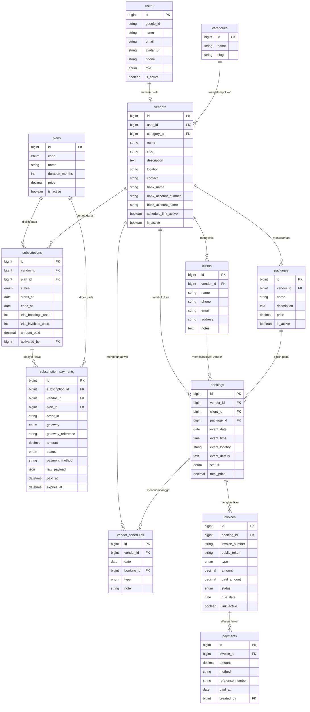

# PRD — Project Requirements Document

## 1. Overview

### Masalah yang Diselesaikan
Vendor wedding di Indonesia — mulai dari Wedding Organizer, fotografer/videografer, venue, dekorasi, MUA, catering, sampai seserahan — masih mengelola pesanan secara manual. Booking dicatat di notes HP atau buku tulis, sehingga rawan bentrok jadwal (double booking), data klien mudah hilang, dan pembuatan invoice dilakukan ulang dengan menyalin data klien ke Word/Excel. Kalau ada calon klien bertanya "tanggal X masih kosong?", vendor harus membuka catatan satu per satu untuk menjawab.

### Tujuan Utama Aplikasi
Aplikasi ini adalah **alat operasional internal khusus vendor wedding**, bukan marketplace dan bukan aplikasi untuk calon pengantin. Vendor memakai aplikasi untuk mencatat booking, melihat jadwal dalam bentuk kalender, menerbitkan invoice, dan membagikan jadwal/invoice ke klien lewat link publik.

- **Vendor** mengelola booking, jadwal, paket, klien, dan invoice dari satu dashboard. Vendor baru langsung mendapat akses penuh ke seluruh fitur sejak login pertama dalam **masa trial** yang dibatasi 2 booking + 2 invoice. Setelah berlangganan, vendor dapat membuat booking & invoice **tanpa batas** selama masa paket aktif.
- **Admin** hanya membantu **mengelola vendor**: menambah/mengundang vendor, memperbarui profil vendor, mengaktifkan/menonaktifkan akun, serta mengatur paket dan masa aktif langganan. Admin **tidak** memverifikasi vendor dan **tidak** memantau booking/invoice vendor.
- **Calon pengantin / klien tidak punya akun dan tidak pernah masuk ke aplikasi.** Komunikasi dan negosiasi dilakukan di luar aplikasi (WhatsApp, Instagram, dsb). Aplikasi baru dipakai vendor setelah kesepakatan tercapai.
- Klien hanya bisa **melihat** dua halaman publik tanpa login: jadwal ketersediaan vendor dan invoice yang dibagikan vendor.

---

## 2. Requirements

### Kebutuhan Fungsional
- Pengguna dapat masuk hanya dengan akun Google (satu klik). Tidak ada registrasi pengantin dan tidak ada form signup publik.
- Sistem hanya mengenal dua peran: **Vendor** dan **Admin**, lalu mengarahkan tiap peran ke tampilan yang sesuai.
- Vendor langsung mendapat akses penuh setelah login pertama; tidak ada proses verifikasi/approval. Vendor dapat mengisi profil usaha (nama, kategori, deskripsi, kontak, rekening pembayaran) kapan saja.
- **Kuota hanya berlaku selama masa trial**: vendor baru mendapat batas **2 booking + 2 invoice** yang bersifat sekali pakai (tidak direset). Setelah trial habis, vendor masih bisa membuka dan mengisi form booking ketiga, tetapi submit ditolak server dan muncul **modal upgrade langganan**. Begitu vendor berlangganan paket apa pun (bulanan/3 bulan/tahunan), **booking dan invoice menjadi tanpa batas** selama masa aktif paket — tidak ada kuota yang direset per bulan.
- Langganan berbayar: **Bulanan Rp50.000**. Tersedia juga paket **3 bulan** dan **tahunan** dengan harga yang belum final (dapat diatur admin dari dashboard, tanpa deploy ulang).
- **Pembayaran langganan dilakukan online lewat payment gateway** (Midtrans atau Duitku, belum final). Vendor memilih paket, checkout di halaman pembayaran gateway, lalu setelah pembayaran sukses dan webhook terverifikasi masa aktif paket aktif otomatis tanpa campur tangan admin. Admin tetap bisa mengaktifkan manual bila ada kendala.
- Vendor membuat booking dari dashboard dengan mengisi data klien (nama, no. HP/WA, catatan) dan data acara (tanggal, paket, harga, lokasi, jam, detail kebutuhan).
- Setelah booking tersimpan, data booking langsung muncul di dashboard dan pada kalender jadwal vendor.
- Vendor memiliki **dashboard kalender** bulanan; klik tanggal menampilkan detail klien yang booking pada tanggal tersebut.
- Dashboard vendor juga menampilkan **satu grafik bulanan bergradasi** (bar) untuk 12 bulan terakhir sebagai ringkasan performa: jumlah booking per bulan dan pendapatan yang benar-benar diterima per bulan.
- Vendor dapat membuat invoice dengan data klien & booking yang **terisi otomatis** dari booking terkait — tanpa mengetik ulang.
- Invoice mendukung tagihan DP (uang muka) dan pelunasan/sisa, dengan nominal, jatuh tempo, dan status pembayaran.
- Invoice dapat **diekspor ke PDF** dan dibagikan sebagai **link publik** yang bisa dibuka klien tanpa login.
- Pembayaran tagihan klien dilakukan lewat **transfer manual ke rekening vendor**; vendor menandai invoice/booking sebagai **LUNAS** (atau mencatat pembayaran sebagian) dari dashboard. Tagihan klien **tidak** memakai payment gateway karena dana masuk langsung ke rekening vendor.
- Vendor dapat membuat **link jadwal publik**; klien membuka link tersebut untuk melihat tanggal mana yang masih kosong dan mana yang sudah terbooking.
- Admin dapat mengelola vendor dan langganan vendor: menambah/mengundang, mengubah profil, mengaktifkan/menonaktifkan akun, serta mengatur paket dan masa aktif. Admin tidak memiliki akses ke data booking, klien, atau invoice vendor.
- Tersedia halaman promosi (landing page) yang clean, modern, dan minimalis, ditujukan untuk vendor.

### Kebutuhan Non-Fungsional
- Antarmuka sederhana dan mudah dipahami vendor non-teknis; input booking harus selesai dalam satu form singkat.
- Data booking, klien, dan invoice tersimpan permanen dan dapat dicari kembali.
- Mencegah double booking lewat validasi tanggal pada saat pembuatan booking dan penandaan tanggal terisi.
- Halaman publik (jadwal & invoice) tidak boleh membocorkan data pribadi klien lain: jadwal publik hanya menampilkan status tanggal kosong/terisi, invoice publik hanya menampilkan data invoice yang bersangkutan.
- Link publik menggunakan token acak yang tidak bisa ditebak dan dapat dinonaktifkan/di-reset vendor.
- **Pembayaran langganan via payment gateway harus aman**: signature/key webhook diverifikasi di server, `order_id` dan nominal dicocokkan sebelum langganan diaktifkan, dan penanganan webhook bersifat idempoten agar notifikasi ganda tidak memperpanjang masa aktif dua kali. Kredensial gateway disimpan di environment, bukan di database.
- Batas trial ditegakkan di server: selama status trial, pembuatan booking/invoice ke-3 ditolak API dan frontend menampilkan modal upgrade; data form yang sudah diisi tidak hilang. Untuk vendor berlangganan aktif, pengecekan batas dilewati sepenuhnya.
- Sistem berjalan stabil di VPS dengan basis data MySQL.

### Asumsi & Batasan
- **Payment gateway hanya untuk langganan vendor.** Tagihan klien tetap transfer manual ke rekening vendor dan status LUNAS ditandai vendor, tanpa rekonsiliasi otomatis.
- Pilihan gateway: **Midtrans (Snap) atau Duitku (POP)**, belum diputuskan final. Integrasi dibungkus satu adapter sehingga keduanya bisa ditukar tanpa mengubah alur langganan.
- **Tidak ada modul chat/notifikasi klien.** Komunikasi sepenuhnya di luar aplikasi.
- **Tidak ada akun klien, ulasan (review), pencarian/penjelajahan vendor publik, maupun booking online oleh pengantin.**
- **Tidak ada proses verifikasi vendor.** Vendor baru langsung aktif dengan akses penuh dan masuk **masa trial** (2 booking + 2 invoice, sekali pakai).
- **Admin hanya mengelola vendor & langganan**, bukan pengawas operasional. Data booking, klien, invoice, dan pembayaran adalah domain privat masing-masing vendor.
- **Batas hanya pada trial**: trial = 2 booking + 2 invoice total, tanpa reset dan tanpa batas waktu tambahan selain kuota tersebut. Setelah berlangganan (bulanan/3 bulan/tahunan) vendor **unlimited booking & invoice** sampai masa paket berakhir; saat kedaluwarsa vendor kembali tidak bisa membuat data baru sampai memperpanjang.
- Harga **bulanan Rp50.000** sudah pasti; harga paket **3 bulan** dan **tahunan** masih TBD dan disimpan sebagai konfigurasi agar bisa ditetapkan admin kemudian.
- Satu akun Google memegang satu peran utama: vendor atau admin.

---

## 3. Core Features

> Semua fitur di bawah ini disusun mengikuti Kerangka Fitur (Roadmap) yang telah disepakati, dikelompokkan per fase sesuai urutan yang disepakati. Fokus aplikasi: operasional vendor (booking → jadwal → invoice → share).

### Fase 1 — Booking & Jadwal Vendor

**Manajemen Booking oleh Vendor** [high]
- **Form Booking Vendor** — Buat booking baru: nama klien, no. HP/WA, email (opsional), tanggal acara, jam, lokasi, paket, harga, catatan.
- **Data Klien Tersimpan** — Klien dibuat otomatis dari form booking dan dipakai ulang di invoice berikutnya tanpa mengetik ulang.
- **Status Booking** — Tandai booking sebagai tentative, terkonfirmasi, selesai, atau batal.
- **Daftar & Pencarian Booking** — Lihat semua booking, filter berdasarkan bulan, status, atau nama klien.
- **Ubah & Batalkan Booking** — Edit data booking (termasuk reschedule tanggal) atau membatalkannya.

**Batas Trial & Modal Upgrade** [high]
- **Batas Trial 2 Booking** — Selama masa trial, vendor hanya dapat menyimpan 2 booking (sekali pakai, tidak direset). Pembatalan booking tidak mengembalikan jatah trial.
- **Tanpa Batas Setelah Berlangganan** — Vendor dengan langganan aktif (bulanan/3 bulan/tahunan) dapat membuat booking sebanyak apa pun sampai masa paket berakhir.
- **Form Tetap Terbuka** — Saat jatah trial habis, vendor masih bisa membuka dan mengisi form booking; submit diblokir di sisi server.
- **Modal Upgrade** — Begitu submit ditekan, muncul modal berisi alasan jatah trial habis, daftar paket (Bulanan Rp50.000, 3 bulan & tahunan), dan arahan menghubungi admin/transfer. Isian form tetap tersimpan di layar.

**Dashboard Kalender Vendor** [high]
- **Kalender Bulanan** — Tampilan bulanan dengan penanda tanggal yang sudah terbooking; navigasi antar bulan.
- **Detail Klien per Tanggal** — Klik tanggal untuk membuka detail klien yang booking di tanggal itu (nama, paket, status, kontak, link invoice).
- **Double Booking Guard** — Peringatan saat tanggal yang sudah terisi dipilih lagi pada form booking.
- **Blokir Tanggal Manual** — Vendor dapat menandai tanggal yang tidak bisa dipesan (mis. tanggal libur/acara pribadi).

### Fase 2 — Invoice, Pembayaran Manual, Grafik & Share

**Invoice Otomatis dari Booking** [high]
- **Generate Invoice dari Data Booking** — Invoice dibuat dari booking terpilih; data klien, acara, dan harga terisi otomatis.
- **Nomor Invoice & Jatuh Tempo** — Penomoran otomatis dan tenggat pembayaran yang bisa diatur.
- **DP & Pelunasan** — Satu booking bisa punya tagihan DP lalu sisa pelunasan, dengan nominal yang dihitung otomatis.
- **Status Invoice** — Belum dibayar, dibayar sebagian, lunas, dibatalkan.
- **Kelola Invoice** — Daftar semua invoice beserta filter status dan relasi ke booking.
- **Batas Invoice Hanya Saat Trial** — Selama trial maksimal 2 invoice (sekali pakai); setelah berlangganan aktif, invoice tidak dibatasi.

**Pencatatan Pembayaran Manual & Tandai Lunas** [high]
- **Catat Transfer Manual** — Vendor mencatat nominal pembayaran yang masuk (DP/parsial/pelunasan) beserta tanggal dan catatan.
- **Tandai Lunas** — Satu tombol untuk menandai invoice lunas; status booking ikut tercermin.
- **Riwayat Pembayaran per Invoice** — Semua pembayaran manual tercatat sebagai bukti.
- **Rekening Vendor** — Nomor rekening bank vendor ditampilkan di invoice PDF/link agar klien tahu ke mana transfer.

**Grafik Dashboard Vendor** [medium]
- **Grafik Bulanan Bergradasi** — Satu grafik batang (bar) dengan gradasi warna per bulan untuk 12 bulan terakhir, menjadi ringkasan performa di atas/bawah kalender booking.
- **Dua Metrik: Booking & Pendapatan** — Toggle untuk berpindah antara *jumlah booking per bulan* (`bookings.event_date`) dan *pendapatan diterima per bulan* (`payments.amount`, bukan `invoices.grand_total` agar DP + pelunasan tidak terhitung dobel).
- **Agregasi di Server** — Data dihitung dengan `GROUP BY` bulan (zona waktu Asia/Jakarta) dan dikirim sebagai ringkasan kecil, bukan seluruh baris transaksi ke frontend.
- **Empty State** — Bila belum ada data (vendor trial baru), tampilkan ajakan membuat booking pertama, bukan grafik bernilai nol.
- **Grafik Admin Belum Termasuk** — Grafik bisnis untuk dashboard admin sengaja belum masuk lingkup fase ini dan akan diputuskan pada siklus terpisah.

**Export PDF & Share Link Invoice** [high]
- **Export PDF** — Unduh invoice sebagai PDF rapi siap kirim via WhatsApp/email.
- **Link Invoice Publik** — Link bertoken untuk dibuka klien tanpa login, menampilkan rincian tagihan, status, dan instruksi transfer.
- **Kontrol Link** — Vendor dapat menyalin, menonaktifkan, atau me-reset token link invoice.

**Jadwal Publik untuk Klien** [high]
- **Link Jadwal Vendor** — Vendor membagikan satu link jadwal (bertoken/slug) ke calon klien.
- **Tampilan Kosong vs Terbooking** — Kalender publik menunjukkan tanggal tersedia dan tanggal sudah terisi tanpa menampilkan data pribadi klien.
- **Tanpa Login** — Klien cukup membuka link di browser, tanpa akun.
- **Kontrol Link** — Vendor dapat mengaktifkan/menonaktifkan link jadwal kapan saja.

### Fase 3 — Profil Vendor, Langganan & Kelola Vendor

**Profil & Paket Vendor** [medium]
- **Profil Vendor** — Nama usaha, kategori, deskripsi, kontak/WA, dan rekening bank.
- **Kelola Paket & Harga** — Daftar paket layanan dengan harga, dipakai sebagai pilihan cepat saat membuat booking/invoice.
- **Identitas di Dokumen** — Profil (nama, kontak, rekening) dipakai pada header invoice PDF dan halaman publik.

**Langganan & Akses Vendor** [high]
- **Paket Langganan** — Bulanan Rp50.000; paket 3 bulan dan tahunan tersedia dengan harga TBD yang dapat diubah admin.
- **Akses Berbasis Status** — Trial (2 booking + 2 invoice, sekali pakai), aktif (booking & invoice tanpa batas), kedaluwarsa (tidak bisa membuat booking/invoice baru sampai diperpanjang; data lama tetap bisa dibaca & diekspor).
- **Tanpa Reset Kuota** — Trial hanya 2 booking + 2 invoice sekali pakai, tanpa reset. Setelah berlangganan tidak ada batas yang direset per bulan: masa paket hanya menentukan sampai kapan akses tanpa batas berlaku.
- **Checkout Lewat Payment Gateway** — Vendor memilih paket di halaman upgrade lalu diarahkan ke halaman pembayaran gateway (Midtrans Snap / Duitku POP) untuk membayar via QRIS, VA, atau e-wallet. Setelah webhook terverifikasi, langganan aktif otomatis.
- **Perpanjang Sebelum Kedaluwarsa** — Vendor dengan langganan aktif dapat membeli paket lagi; masa aktif baru ditambahkan dari tanggal berakhir paket sebelumnya (bukan dari tanggal bayar).
- **Aktivasi Manual oleh Admin (Fallback)** — Bila webhook gagal atau vendor membayar di luar gateway, admin tetap dapat mengaktifkan/memperpanjang langganan secara manual.

**Dashboard Admin — Kelola Vendor** [medium]
- **Daftar & Tambah Vendor** — Admin melihat semua akun vendor dan dapat menambah/mengundang vendor baru.
- **Edit & Nonaktifkan Vendor** — Ubah profil vendor, aktifkan/nonaktifkan akun yang bermasalah.
- **Pantau Transaksi Langganan** — Admin melihat riwayat transaksi gateway (pending/paid/failed/expired) dan dapat memperpanjang masa aktif secara manual sebagai fallback bila webhook bermasalah; status trial hanya diubah pada kasus khusus.
- **Kelola Harga Paket** — Tetapkan harga paket 3 bulan & tahunan tanpa deploy ulang.
- **Tanpa Akses Operasional** — Admin tidak dapat melihat booking, data klien, invoice, atau pembayaran vendor.

**Masuk dengan Google** [high]
- **Login Satu Klik** — Masuk memakai akun Google yang sudah terdaftar sebagai vendor/admin.
- **Peran Pengguna** — Setiap akun diarahkan ke tampilan sesuai perannya: vendor atau admin.
- **Tanpa Registrasi Publik** — Tidak ada pendaftaran pengantin; akun vendor baru langsung aktif tanpa verifikasi.
- **Akses Penuh Sejak Login Pertama** — Semua fitur vendor langsung tersedia, dibatasi hanya oleh jatah trial 2 booking + 2 invoice; setelah berlangganan semua batas hilang.
- **Profil Akun** — Ubah nama, foto, dan kontak akun.

### Fase 4 — Akuisisi Vendor

**Halaman Promosi** [low]
- **Sorotan Manfaat** — Kelola booking, kalender jadwal, dan invoice vendor dalam satu dashboard.
- **Cara Kerja** — Tiga langkah: buat booking → pantau di kalender → kirim invoice & link jadwal ke klien.
- **Ajakan Masuk** — Tombol menonjol "Masuk dengan Google" untuk vendor.
- **Harga** — Tampilkan paket Bulanan Rp50.000; paket 3 bulan & tahunan ditandai segera hadir/harga menyusul.

## 4. User Flow

### A. Alur Vendor (alur utama aplikasi)
1. **Klien chat vendor di luar aplikasi** (WhatsApp/Instagram) → harga dan tanggal disepakati.
2. **Vendor masuk dengan Google** → akun vendor langsung aktif dengan akses penuh dan jatah trial 2 booking + 2 invoice.
3. **Buat booking** → isi nama klien, no. WA, tanggal & jam acara, paket, harga, catatan. Sistem memvalidasi tanggal belum terisi dan (bila masih trial) sisa jatah trial.
4. **Booking tersimpan** → muncul di daftar booking dan langsung terlihat di kalender dashboard.
5. **Pantau dashboard** → kartu kalender bulanan menampilkan tanggal terisi; klik tanggal → detail klien yang booking di tanggal tersebut. Di halaman yang sama, grafik batang bergradasi 12 bulan terakhir merangkum jumlah booking dan pendapatan diterima per bulan.
6. **Buat invoice dari booking** → data klien & acara terisi otomatis, atur nominal DP/pelunasan dan jatuh tempo.
7. **Bagikan invoice** → export PDF atau kirim link invoice publik ke klien via WhatsApp.
8. **Klien transfer manual** → vendor mencatat pembayaran masuk dan menandai invoice **LUNAS**.
9. **Bagikan link jadwal** → calon klien lain membuka link untuk melihat tanggal kosong/terisi.
10. **Jatah trial habis (booking/invoice ke-3)** → vendor masih bisa mengisi form, tetapi saat submit muncul modal upgrade. Vendor memilih paket → diarahkan ke checkout payment gateway (QRIS/VA/e-wallet) → setelah pembayaran sukses & webhook terverifikasi, langganan aktif otomatis dan form yang tertunda bisa langsung di-submit tanpa mengisi ulang.
11. **Selesaikan booking** → setelah acara, tandai booking "Selesai"; semua data tersimpan sebagai riwayat.

### B. Alur Klien / Calon Pengantin (tanpa akun)
1. **Chat vendor di luar aplikasi** → tanya harga & ketersediaan tanggal.
2. **Buka link jadwal vendor** (opsional) → melihat kalender dengan tanggal kosong vs terbooking, tanpa login dan tanpa melihat data klien lain.
3. **Deal dengan vendor** → vendor yang membuat booking di aplikasi (klien tidak mengisi apa pun).
4. **Menerima link invoice / PDF** → melihat rincian tagihan, status, dan nomor rekening vendor.
5. **Transfer manual** → setelah vendor menandai lunas, klien bisa membuka kembali link yang sama untuk melihat status terbaru.

### C. Alur Admin
1. **Masuk dengan Google** → sistem mengenali peran sebagai admin.
2. **Kelola vendor** → tambah/mengundang vendor, edit profil, aktifkan/nonaktifkan akun.
3. **Pantau & bantu langganan** → memeriksa transaksi gateway yang bermasalah, memperpanjang masa aktif secara manual sebagai fallback, dan mengubah status trial pada kasus khusus.
4. **Kelola harga paket** → tetapkan harga 3 bulan & tahunan.
5. Tidak ada akses ke booking, data klien, invoice, atau pembayaran vendor.

---

## 5. Architecture

Aplikasi memakai arsitektur **client-server terpisah**: React sebagai antarmuka (SPA) untuk dashboard vendor & admin plus dua halaman publik, Laravel sebagai penyedia API dan logika bisnis, MySQL sebagai basis data, semuanya di satu VPS. Autentikasi Google (OAuth 2.0) hanya untuk vendor & admin; vendor baru langsung aktif tanpa verifikasi dan mulai dari masa trial. Ada **dua jalur pembayaran yang terpisah tegas**: (1) tagihan klien dibayar **transfer manual ke rekening vendor** dan vendor menandai lunas, (2) **langganan vendor dibayar online lewat payment gateway** (Midtrans Snap atau Duitku POP) dan diaktifkan oleh webhook terverifikasi. Setiap pembuatan booking/invoice divalidasi terhadap **status langganan** di server: selama status trial, batas 2 booking + 2 invoice ditegakkan; setelah berlangganan aktif, pengecekan batas dilewati. Invoice PDF di-generate di server; link publik memakai token acak yang divalidasi per request.

```mermaid
sequenceDiagram
    participant K as Klien (chat di luar aplikasi)
    participant V as Vendor (React SPA)
    participant G as Google OAuth
    participant L as Laravel API
    participant DB as MySQL
    participant GW as Payment Gateway (Midtrans/Duitku)
    participant P as Halaman Publik (React)

    V->>G: Klik "Masuk dengan Google"
    G-->>L: Kirim token OAuth + data profil
    L->>DB: Cari akun & peran (vendor/admin)
    L-->>V: Sesi login + arahkan ke dashboard vendor

    Note over K,V: Negosiasi harga & tanggal via WhatsApp/IG (di luar aplikasi)

    Note over V,L: Fase trial: batas 2 booking + 2 invoice (sekali pakai)

    V->>L: Buat booking (data klien, tanggal acara, paket, harga)
    L->>DB: Cek status langganan vendor + cek tanggal terisi
    alt Trial habis (booking/invoice ke-3)
        L-->>V: 422 trial_limit_reached + daftar paket
        V-->>V: Tampilkan modal upgrade (form tetap terisi)
        V->>L: Pilih paket → minta transaksi
        L->>GW: Buat transaksi langganan (order_id + nominal)
        L-->>V: Snap/payment URL atau token pembayaran
        V-->>GW: Vendor bayar (QRIS/VA/e-wallet)
        GW->>L: Webhook notifikasi status
        L->>L: Verifikasi signature, cocokkan order_id & nominal (idempoten)
        L->>DB: Tandai transaksi paid + aktifkan/perpanjang langganan
        L-->>V: Langganan aktif → submit form booking dapat dilanjutkan
    else Langganan aktif
        L->>DB: Simpan klien + booking + tandai tanggal terisi (tanpa batas)
        L-->>V: Booking tersimpan, muncul di daftar & kalender
    end

    V->>L: Klik tanggal di kalender
    L->>DB: Query booking + klien pada tanggal itu
    L-->>V: Detail klien (nama, paket, status, link invoice)

    V->>L: Buat invoice dari booking
    L->>DB: Simpan invoice (nomor, nominal, jatuh tempo, token publik)
    L-->>V: Invoice siap; PDF dapat diunduh, link publik dapat dibagikan

    V-->>K: Kirim PDF / link invoice (WhatsApp)
    K->>L: Buka link invoice publik (token)
    L->>DB: Validasi token & ambil data invoice
    L-->>K: Rincian tagihan + rekening vendor + status

    K->>V: Transfer manual ke rekening vendor (di luar aplikasi)
    V->>L: Catat pembayaran / tandai LUNAS
    L->>DB: Simpan payment + status invoice = paid
    L-->>K: Link invoice menampilkan status LUNAS

    K->>L: Buka link jadwal vendor
    L->>DB: Ambil tanggal terisi (tanpa data pribadi klien)
    L-->>K: Kalender: tanggal tersedia vs terbooking
```

---

## 6. Database Schema

Berikut tabel-tabel utama yang dibutuhkan beserta kolom intinya.

**users** — akun vendor dan admin (tidak ada akun klien).
- `id` (bigint, PK) — identitas unik.
- `google_id` (string) — ID dari akun Google.
- `name` (string) — nama pengguna.
- `email` (string, unik) — alamat email Google.
- `avatar_url` (string) — foto profil.
- `phone` (string) — kontak.
- `role` (enum: vendor, admin) — peran pengguna.
- `is_active` (boolean) — status aktif/nonaktif.
- `created_at`, `updated_at` (timestamp).

**vendors** — profil usaha vendor pemilik akun.
- `id` (bigint, PK).
- `user_id` (bigint, FK → users.id, unik) — pemilik akun vendor.
- `category_id` (bigint, FK → categories.id) — jenis vendor.
- `name` (string) — nama usaha vendor.
- `slug` (string, unik) — penanda link jadwal publik.
- `description` (text) — deskripsi layanan.
- `location` (string) — kota/daerah.
- `contact` (string) — kontak/WA yang tampil di invoice & halaman publik.
- `bank_name` (string) — nama bank untuk transfer.
- `bank_account_number` (string) — nomor rekening.
- `bank_account_name` (string) — nama pemilik rekening.
- `schedule_link_active` (boolean) — aktif/nonaktif link jadwal publik.
- `is_active` (boolean) — status akun vendor (diatur admin).
- `created_at`, `updated_at` (timestamp).

**plans** — paket langganan yang dapat diatur admin.
- `id` (bigint, PK).
- `code` (enum: monthly, quarterly, yearly) — kode paket.
- `name` (string) — nama paket (mis. "Bulanan").
- `duration_months` (int) — 1, 3, atau 12.
- `price` (decimal, nullable) — Rp50.000 untuk bulanan; 3 bulan & tahunan TBD (null sampai ditetapkan admin).
- `is_active` (boolean) — tampil/tidak di halaman upgrade.
- Catatan: tabel ini **tidak** menyimpan batas booking/invoice. Batas hanya milik masa trial dan nilainya konstan (2 + 2) di konfigurasi aplikasi.

**subscriptions** — periode langganan vendor dan penghitung pemakaian masa trial.
- `id` (bigint, PK).
- `vendor_id` (bigint, FK → vendors.id).
- `plan_id` (bigint, FK → plans.id, nullable) — null untuk trial/gratis.
- `status` (enum: trial, active, expired, cancelled) — status periode.
- `starts_at` (date), `ends_at` (date) — masa berlaku.
- `trial_bookings_used` (int) — jumlah booking yang sudah dibuat **selama trial** (tidak dipakai lagi setelah berlangganan).
- `trial_invoices_used` (int) — jumlah invoice yang sudah dibuat **selama trial**.
- `amount_paid` (decimal) — nominal langganan yang tercatat lunas (dari transaksi gateway).
- `activated_by` (bigint, FK → users.id, nullable) — admin yang mengaktifkan manual; null bila aktivasi otomatis lewat webhook.
- `created_at`, `updated_at` (timestamp).
- Hanya satu subscription berstatus `trial`/`active` per vendor pada satu waktu.

**subscription_payments** — transaksi pembayaran langganan melalui payment gateway.
- `id` (bigint, PK).
- `subscription_id` (bigint, FK → subscriptions.id, nullable) — langganan yang diaktifkan transaksi ini.
- `vendor_id` (bigint, FK → vendors.id).
- `plan_id` (bigint, FK → plans.id) — paket yang dibeli.
- `order_id` (string, unik) — ID transaksi internal yang dikirim ke gateway.
- `gateway` (enum: midtrans, duitku) — gateway yang dipakai.
- `gateway_reference` (string, nullable) — ID transaksi dari gateway.
- `amount` (decimal) — nominal yang harus dibayar.
- `status` (enum: pending, paid, failed, expired, refunded) — status transaksi.
- `payment_method` (string, nullable) — channel yang dipakai (QRIS/VA/e-wallet).
- `raw_payload` (json, nullable) — payload webhook terakhir untuk audit.
- `paid_at` (datetime, nullable), `expires_at` (datetime, nullable).
- `created_at`, `updated_at` (timestamp).

**categories** — daftar kategori vendor (WO, fotografer, venue, dekor, MUA, catering, seserahan).
- `id` (bigint, PK).
- `name` (string) — nama kategori.
- `slug` (string) — penanda URL.

**packages** — paket layanan vendor, dipakai sebagai pilihan cepat saat booking.
- `id` (bigint, PK).
- `vendor_id` (bigint, FK → vendors.id).
- `name` (string) — nama paket.
- `description` (text) — rincian paket.
- `price` (decimal) — harga paket.
- `is_active` (boolean) — tampil/tidak di form booking.

**clients** — data klien milik vendor (dibuat dari form booking, bukan akun login).
- `id` (bigint, PK).
- `vendor_id` (bigint, FK → vendors.id) — vendor pemilik data.
- `name` (string) — nama klien / pasangan pengantin.
- `phone` (string) — no. HP/WhatsApp.
- `email` (string, nullable) — email klien.
- `address` (string, nullable) — alamat/kota klien.
- `notes` (text, nullable) — catatan internal vendor.
- `created_at`, `updated_at` (timestamp).

**bookings** — data pemesanan yang dibuat vendor.
- `id` (bigint, PK).
- `vendor_id` (bigint, FK → vendors.id) — vendor yang membukukan.
- `client_id` (bigint, FK → clients.id) — klien terkait.
- `package_id` (bigint, FK → packages.id, nullable) — paket yang dipilih.
- `event_date` (date) — tanggal acara.
- `event_time` (time, nullable) — jam acara.
- `event_location` (string, nullable) — lokasi acara.
- `event_details` (text/json, nullable) — kebutuhan acara & catatan.
- `status` (enum: tentative, confirmed, completed, cancelled) — status booking.
- `total_price` (decimal) — total biaya yang disepakati.
- `created_at`, `updated_at` (timestamp).
- Indeks unik (`vendor_id`, `event_date`) untuk mencegah double booking pada booking aktif.

**vendor_schedules** — penanda tanggal terisi/blokir untuk kalender & anti double booking.
- `id` (bigint, PK).
- `vendor_id` (bigint, FK → vendors.id).
- `date` (date) — tanggal terisi.
- `booking_id` (bigint, FK → bookings.id, nullable) — booking terkait; null bila tanggal diblokir manual.
- `type` (enum: booked, blocked) — sumber penandaan tanggal.
- `note` (string, nullable) — alasan blokir.

**invoices** — tagihan yang dibuat dari data booking.
- `id` (bigint, PK).
- `booking_id` (bigint, FK → bookings.id).
- `invoice_number` (string, unik) — nomor invoice.
- `public_token` (string, unik) — token link invoice publik.
- `type` (enum: full, dp, pelunasan) — jenis tagihan.
- `amount` (decimal) — jumlah tagihan.
- `paid_amount` (decimal) — akumulasi pembayaran tercatat.
- `status` (enum: unpaid, partial, paid, cancelled) — status pembayaran.
- `due_date` (date, nullable) — tenggat pembayaran.
- `note` (text, nullable) — catatan untuk klien.
- `link_active` (boolean) — aktif/nonaktif link publik.
- `created_at`, `updated_at` (timestamp).

**payments** — riwayat pembayaran manual (transfer) yang dicatat vendor.
- `id` (bigint, PK).
- `invoice_id` (bigint, FK → invoices.id).
- `amount` (decimal) — nominal yang ditransfer.
- `method` (string) — metode, default "transfer".
- `reference_number` (string, nullable) — nomor referensi/bukti transfer.
- `note` (string, nullable) — catatan vendor.
- `paid_at` (date) — tanggal pembayaran diterima.
- `created_by` (bigint, FK → users.id) — vendor yang mencatat.
- `created_at` (timestamp).



---

## 7. Tech Stack

| Lapisan | Teknologi | Alasan |
|---|---|---|
| **Frontend** | React | SPA responsif untuk dashboard vendor (kalender, booking, invoice) dan halaman publik jadwal/invoice yang ringan. |
| **Backend** | Laravel | Mengelola autentikasi OAuth, API booking/invoice, validasi anti double booking, dan generate PDF. |
| **Database** | MySQL | Basis data relasional untuk relasi vendor → klien → booking → invoice → pembayaran. |
| **Autentikasi** | Google OAuth 2.0 (via Laravel Socialite) | Login satu klik hanya untuk vendor & admin; tidak ada registrasi publik. |
| **PDF Invoice** | Library PDF Laravel (mis. dompdf / snappy) | Menghasilkan file invoice siap kirim dari data booking tanpa input ulang. |
| **Payment Gateway Langganan** | Midtrans Snap (rekomendasi) atau Duitku POP, dibungkus adapter `SubscriptionGateway` | Menangani QRIS/VA/e-wallet/kartu untuk pembayaran langganan vendor; Snap menyediakan halaman pembayaran siap pakai sehingga UI pembayaran tidak perlu dibangun sendiri. Dipilih salah satu, tetap bisa ditukar tanpa mengubah alur karena adapter. |
| **Link Publik** | Token acak (UUID/random string) | Halaman invoice & jadwal dapat dibuka klien tanpa login dan bisa dinonaktifkan vendor. |
| **Chart Dashboard** | Recharts (React) | Grafik batang bulanan bergradasi di dashboard vendor; data agregat dikirim dari API, bukan dihitung di browser. |
| **Deployment** | VPS (mis. Nginx + PHP-FPM) | Kontrol penuh atas server, biaya terjangkau, performa stabil. |

### Catatan Implementasi
- Frontend React dan backend Laravel berkomunikasi lewat REST API; halaman publik memakai endpoint terpisah tanpa auth berbasis token/slug.
- **Dua jalur pembayaran, jangan dicampur**: (1) invoice acara klien = transfer manual ke rekening vendor, status LUNAS hanya berubah lewat aksi vendor — **tidak ada gateway di jalur ini**; (2) langganan vendor = payment gateway + webhook. Dana langganan masuk ke rekening pemilik aplikasi, bukan ke vendor.
- **Alur langganan**: `POST /api/subscription/checkout` membuat baris `subscription_payments` berstatus `pending` dan meminta transaksi ke gateway → gateway mengembalikan token/URL pembayaran → `POST /api/webhooks/{gateway}` (tanpa auth, verifikasi signature) memperbarui status dan mengaktifkan/memperpanjang `subscriptions`. Handler webhook harus **idempoten** (kunci pada `order_id`) dan hanya mengaktifkan bila nominal cocok.
- Saat langganan aktif, perpanjangan menambahkan durasi dari `ends_at` lama (bukan dari tanggal bayar) agar masa aktif tidak hangus.
- Selama trial, endpoint pembuatan booking/invoice mengecek `trial_bookings_used`/`trial_invoices_used` (maks. 2) dan mengembalikan 422 `trial_limit_reached`; vendor `active` melewati pengecekan ini sepenuhnya. Frontend menampilkan modal upgrade tanpa menghapus isian form.
- Kredensial gateway (server key, client key, merchant code) disimpan di `.env`; nominal transaksi selalu dihitung ulang di server dari tabel `plans`, tidak dipercaya dari request frontend.
- Endpoint publik jadwal hanya mengembalikan daftar tanggal + status (tersedia/terisi), tanpa nama klien, harga, atau detail acara.
- **Grafik dashboard vendor** disajikan oleh endpoint agregat (mis. `GET /api/dashboard/summary?months=12`) yang mengembalikan `[{month, bookings, revenue}]`. Sumber "pendapatan" **wajib** `payments.amount` dengan `SUM` per bulan, bukan `invoices.grand_total` (invoice bertipe `dp` + `pelunasan` akan menyebabkan double count). Tambahkan indeks `bookings(vendor_id, event_date)` dan `payments` join ke `invoices(vendor_id, paid_at)` agar query tetap ringan. Dashboard merender **satu** grafik bar bergradasi dengan toggle metrik, dipasangkan dengan kartu kalender booking.
- Endpoint publik invoice hanya mengembalikan data invoice & data vendor pada token tersebut; token yang dinonaktifkan mengembalikan 404.
- Salespage dibangun sebagai halaman statis React yang ringan, dengan tombol "Masuk dengan Google" sebagai fokus utama untuk vendor.
- Perubahan cakupan dari versi sebelumnya: fitur Jelajah Vendor, Pencarian & Filter, Detail Vendor publik, Booking online oleh pengantin, Riwayat booking pengantin, Review/ulasan, serta Kunci akses sebelum bayar **dihapus** dari lingkup. Penegasan: payment gateway hanya dipakai untuk langganan vendor, bukan untuk tagihan klien.